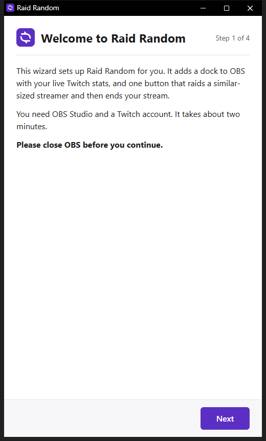

# Raid Random

A free helper for Twitch streamers on Windows, for use with OBS Studio. It adds a dock to OBS
with your live Twitch stats, and one button that raids a similar-sized live streamer and then
ends your stream.

**This is an early test version. There is no download yet:** the raid button has not been used
for a real raid so far.

## What it does

- **Stats in OBS:** viewers, peak viewers, new followers, new subs, stream time, total followers
  and subs. You choose which, and how often they update, with the gear in the dock. A small timer
  shows when the next update comes.
- **Raid button:** suggests a live channel in your category with a similar number of viewers. You
  see the name and confirm before anything happens.
- **Careful ending:** your stream is only stopped after Twitch confirms that exact raid, with a
  few seconds to change your mind. If anything is unclear, your stream keeps running and the dock
  asks you.

## Privacy

**Signing in with Twitch adds you to the Raid Random network**, so other members can raid you.
Signing out removes you.

| What the Raid Random website gets | When |
| --- | --- |
| Your channel name, when you are live, your category, a rough viewer count, the app version | While you are signed in |
| Your exact viewer count, the channels that could be raided, how the raid ended | When you use the raid button |
| Your Twitch sign-in, once, to check with Twitch that it is really you. It is not kept | When you join |

Your entry is kept until you sign out. Raids you sent are kept for up to 90 days, or until you
sign out. Raids others sent you stay in their history for up to 90 days. If a streamer is blocked,
that block is kept.

The app asks Twitch for three permissions: start raids, read followers, and read subs. Your
sign-in stays on your PC in `%APPDATA%\RaidRandom\auth.json`. It is not encrypted, so treat that
file like a password.

## Run the code

You need Windows and [Node.js](https://nodejs.org) 22 or newer.

- `try-demo.bat` shows everything with made-up numbers. It does not contact Twitch or change OBS.
- `start.bat` runs the real app. To use your own Twitch app instead, see `docs/SETUP.md`.
- Tests: run `node --test` inside `app`.
- Build the .exe: run `npm install` inside `build`, then `node build/build.mjs`.

## Removing it

Sign out in the settings window to leave the network. Untick both boxes under Setup and press Save
to remove the dock and the Windows start, then press Quit. Backups of your OBS settings sit next to
the original, named `user.ini.raid-random-....bak`. The app's files are in `%LOCALAPPDATA%\RaidRandom`
and `%APPDATA%\RaidRandom`.

## Using this code

You may download and use the app for free. No other license is given at the moment.

The .exe contains Node.js. Its license text is in `app/public/licenses.txt` and in the app under Licenses.

Raid Random is not affiliated with Twitch or OBS.
